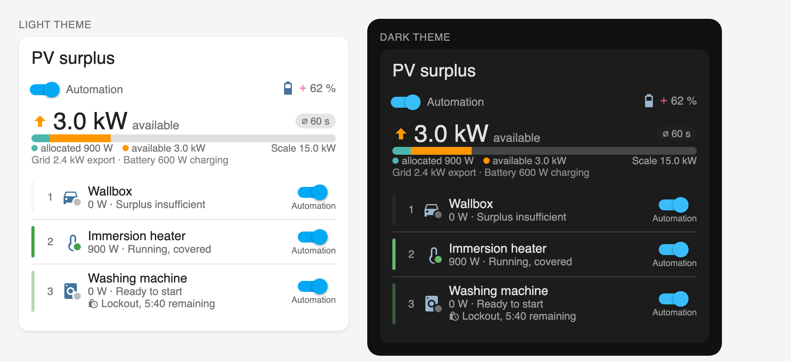

# Energy Manager Card

A Lovelace card for Home Assistant that displays the current **PV surplus** and lists loads **by
priority**. Answers one question at a glance: is there enough surplus for this device?

It is the display half of the
**[Energy Manager Integration](https://github.com/eltomato89/EnergyManagerIntegration)**: the
integration calculates the surplus, keeps the loads and switches them automatically by priority —
the card finds it on its own and displays it. **Loads are maintained exclusively in the
integration.**

The card is not meant to be used without the integration. It still runs — it then shows the
surplus from sensors you configure yourself — but without loads there is little point to it.
Configurations from earlier versions keep working; see [Legacy configurations](#legacy-configurations).

Card and integration are versioned **independently** — the numbers are deliberately not kept in
lockstep, because the two sides share an attribute contract, not a release cadence. Minimum
integration versions per feature, and the reasoning behind that choice, are in the
[interface contract](docs/integration-contract.md#versionierung-getrennte-nummern-dokumentierte-mindestversion).



<sub>Shown: 2.4 kW export plus 600 W battery charging make 3.0 kW of available surplus. The wallbox
needs at least 4.2 kW and stays grey, the immersion heater is running and covered, the washing
machine would be ready — but is still under its minimum off time.</sub>

<sub>Note: the image was produced in a test environment (`tools/preview.html`). The card itself is
the shipped bundle; the surrounding Home Assistant elements (card frame, toggles, state icons) are
recreated for the screenshot and look slightly different in a real installation.</sub>

## Installation

### HACS (recommended)

1. HACS → Dashboard → ⋮ menu → **Custom repositories**
2. Add the repository URL, category **Dashboard**
3. Install "Energy Manager Card"
4. Clear the browser cache (Ctrl+F5)

### Manual

1. Copy `energy-manager-card.js` from the [latest release](../../releases/latest) to `/config/www/`
2. Settings → Dashboards → ⋮ → Resources → Add:
   URL `/local/energy-manager-card.js?v=0.5.2`, type **JavaScript module**

## Configuration

Everything that concerns the card itself can be set in the graphical editor. Loads are not part of
that — they come from the integration.

With the Energy Manager integration installed, this is enough:

```yaml
type: custom:energy-manager-card
```

Meter sensors, batteries, smoothing and the list of loads all come from the integration; the editor
hides those fields and points there instead. Loads and batteries are maintained under **Settings →
Devices & Services → Energy Manager**, each of them as an entry of its own. That way there is
exactly one place for every setting — keeping the same list in two places would inevitably let them
drift apart.

The card header additionally gets the **main switch of the automation**. With it off, nothing is
switched.

If you have the integration installed but do not want to use it for one particular card, set
`use_integration: false` in YAML. Deliberately without a toggle in the editor: this is a fallback,
not a second mode of operation.

### Full example

See [`docs/examples.yaml`](docs/examples.yaml) and the option table in
[`docs/configuration.md`](docs/configuration.md).

## Reordering and switching the automation from the dashboard

With the integration both work **without any preparation**: it creates a `number.…_priority` and a
`switch.…_automation` per load, and the card operates them.

- An icon in the card header enables **reorder mode**. Only then do handles and arrow buttons
  appear — permanently visible, they would move priorities by accident while scrolling on a tablet.
  When reordering, the card writes the ranks as a gapless 1…n.
- The **toggle on the right switches the automation**, not the device. A coloured dot on the icon
  shows whether the device is running; you can still switch it from the detail dialog (click the
  name or icon). Set `switch_action: device` if you prefer otherwise.
- The **main switch** in the header stops the entire automation.

The reason entities are needed for this is technical: **a Lovelace card cannot write its own
configuration at runtime.** An order changed from the dashboard would otherwise be gone after a
reload.

## The four timing fields per load

They are the most common stumbling block because they sound alike. They act at different points and
do **not** replace one another:

| Field            | Acts                     | Protects against                                      |
| ---------------- | ------------------------ | ----------------------------------------------------- |
| `turn_on_delay`  | **before** switching on  | starting during a brief drop in production            |
| `turn_off_delay` | **before** switching off | stopping because of a passing cloud                   |
| `min_runtime`    | **after** switching on   | runtimes that are too short (wash cycle, heat pump)   |
| `min_off_time`   | **after** switching off  | restarting too early (compressor pressure equalising) |

A compressor typically needs `min_off_time: 600`, a wallbox rather `turn_on_delay: 120` together
with `min_runtime: 900`.

These fields are set on the load in the integration, and they are enforced there. The card shows
the resulting countdown from the integration's exact timestamp.

## Home batteries

Optional, and there can be **more than one**. With the integration each battery is an entry of its
own with its own device. Without the integration the card handles exactly one battery from sensors
you configure yourself; those options are unchanged, see
[Legacy configurations](#legacy-configurations).

Charging power always counts as _divertible_ power towards the surplus: what is currently flowing
into a battery could go to a load instead. With several batteries that is their combined charging
power.

### One row per battery

The card builds **one row per battery**, from that battery's own traffic-light sensor. The row
carries the name of the battery — with several of them a fixed label "Battery" would no longer say
which one is meant.

Only a battery with a **maximum charge power** entered gets a row. Without that figure it takes no
part in the priority order and remains a correction term in the balance; a row with a rank would
promise scheduling that does not take place.

Loads ranked **above** a battery are served first and stay on; the battery reserves up to its charge
power at its rank; only what is left goes to loads ranked **below** it. The row has no switch — a
battery is not commanded, only scheduled — but it can be dragged to any position like a load.

Where a load has its toggle, a battery row shows the **charge priority limit** as a percentage.
Tapping it opens Home Assistant's dialog for the `number` entity behind it, which brings the slider
along; the card adds no control of its own. While the limit is taking effect, the value is
highlighted and the second line of the row says so.

The limit is a **claim within the order**, not a blanket block on the surplus: a battery below its
limit moves ahead of all loads and is served first, and whatever is left over still goes to the
loads.

### The battery badge in the header

The badge appears only when there is **exactly one** battery. With several, the integration reports
no overall state of charge any more — a meaningful figure would need the capacities, and 5 kWh at
20 % plus 10 kWh at 80 % is not 50 %. Instead of a guessed number the individual states of charge
are shown in the rows.

### Charging, discharging and the surplus

How **discharging** is treated is set per battery — in the integration on the battery's entry, in
the card's own configuration as `battery_mode`:

| Mode                    | Formula                   | Meaning                                                                                    |
| ----------------------- | ------------------------- | ------------------------------------------------------------------------------------------ |
| `charge_only` (default) | `−grid + max(battery, 0)` | "How much can I switch on without drawing from the grid?" The battery may contribute.      |
| `full`                  | `−grid + battery`         | "How much does the PV deliver beyond the house load?" Stored energy counts as unavailable. |

The difference is substantial. Example: 463 W PV, 842 W house consumption, battery discharging at
386 W, 7 W coming from the grid.

- `charge_only` → **7 W deficit** — the house runs practically self-sufficient, the battery covers
  the gap
- `full` → **393 W deficit** — that much the PV falls short of the house load

`charge_only` is the default because `full` reports a deficit while the battery discharges that
plainly contradicts the meter reading. Choose `full` if you want to reserve the battery for the
evening.

Two further settings belong to each battery in the integration:

- **charge priority limit** — up to this state of charge the battery is served ahead of the loads.
  It is the value in the row and can be adjusted there; 0 switches the rule off. Without a state of
  charge sensor there is neither an entity nor an effect.
- **reserve power** — power kept for the battery at all times, deducted before the first load.

Below the large figure the card also shows the **actual meter readings** ("Grid 7 W import ·
Battery 386 W discharging" — with several batteries their combined power), so that the calculated
surplus and the real grid flow are not confused.

If a battery sensor fails, the card carries on without it but marks the value as uncertain rather
than presenting a wrong result as reliable.

## Smoothing

`smoothing_window` (default 60 s) averages the surplus **time-weighted**: every reading applies
until the next one arrives. A sensor at 3000 W for 55 s and 0 W for 5 s yields 2750 W — not 1500 W
as a plain average would. `0` disables smoothing.

## How the states are assigned

The surplus is distributed as a budget in priority order. With 2000 W of surplus and five devices
of 1500 W each, exactly **one** turns green — not all five.

| Indicator     | Meaning                                         |
| ------------- | ----------------------------------------------- |
| green, solid  | running, covered by the surplus                 |
| orange, solid | running, but drawing from the grid              |
| green, faded  | off, the surplus would be sufficient            |
| orange, faded | off, surplus marginal (from 80 % of the demand) |
| grey          | off, surplus insufficient                       |

## Common problems

**"A sensor does not measure power"** — a kWh meter is configured instead of a W sensor. An energy
meter reports an amount, not an instantaneous value. In that case the card deliberately shows no
value rather than silently assuming 0 W.

**The surplus has the wrong sign** — toggle `invert_grid`. Verify in sunshine: while exporting, the
figure must be positive.

**The card does not load after an update** — HA caches the resource aggressively. Clear the cache;
with a manual installation, increment `?v=<version>` in the resource URL.

## Legacy configurations

Before the integration existed, the card calculated the surplus itself and kept its own list of
loads. Those configurations keep working, but nothing here is maintained in the editor any more —
two places for the same list was precisely the problem the integration solves.

**Meter source.** Either a single bidirectional grid sensor:

```yaml
type: custom:energy-manager-card
grid_entity: sensor.grid_power # >0 import, <0 export
```

If your sensor uses the opposite sign (positive while exporting), set `invert_grid: true`.

Or separate sensors for production and consumption, both always positive:

```yaml
meter_mode: split
production_entity: sensor.pv_production
consumption_entity: sensor.house_consumption
```

Both yield the same surplus — the formula is verified against both paths.

**Home battery.** Without the integration the card handles **exactly one** battery, from
`battery_soc_entity` and `battery_power_entity` (or `battery_charge_entity` /
`battery_discharge_entity`), with `battery_mode`, `battery_min_soc` and `battery_reserve_w`. These
options are unchanged and keep working.

`battery_min_soc` acts here under the old rule: below that state of charge the card reports no
surplus at all, so charging blocks the loads instead of taking a rank ahead of them. There is no
battery row, no rank and no adjustable limit in the card — those come from the integration.

**Loads and their priority.** Priority and automation participation each need one helper per load.
Those helpers were the very reason the integration was built: two real HA helpers per load,
accumulating in the instance.

```yaml
devices:
  - switch_entity: switch.wallbox
    power_entity: sensor.wallbox_power
    priority_entity: input_number.prio_wallbox # or a number entity
    auto_entity: input_boolean.auto_wallbox # or a switch
    max_power: 11000
```

Either **all** loads have a priority helper or none do. A mix produces an order derived partly from
helper values and partly from list positions, which is hard to predict.

The four timing fields may be set here too, but nobody enforces them without the integration — the
card only estimates the countdown from `last_changed` of the switch entity. That is a hint, not a
lock.

## Development

```bash
npm install
npm run check      # format + lint + typecheck + test
npm run build      # -> dist/energy-manager-card.js (single file)
npm run dev        # watch build
npm run serve      # dev server on :4000, usable as an HA resource
```

The calculation core (`src/lib/`) is covered by Vitest — units, signs, battery correction, time
weighting, budget cascade and lockout periods. That is where the errors sit that are hard to
reproduce in a running installation.

`tools/preview.html` produces the screenshot above from the built bundle.

## Licence

MIT
